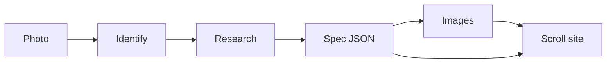

# explode

A photo of a physical thing goes in. A scroll-driven “how it’s made” site comes out.

The committed demo is the [Hamilton Khaki Field Murph 38mm](https://www.hamiltonwatch.com/en-us/h70405730-khaki-field-murph-38mm.html), reference **H70405730**. Scroll the page and the watch comes apart: sapphire, cathedral hands, dial, H-10, crown, case, exhibition caseback, strap, buckle. Nothing on that page is a 3D model. The parts are layered drawings with depth, parallax, and a camera move.

```bash
npm install
npm run dev
```

Then open [http://127.0.0.1:4317](http://127.0.0.1:4317).

## What works without a key

- The Murph demo (`npm run dev`, or `npm run build && npm run preview`).
- Rendering any spec you already have:

```bash
npm run explode -- --from-spec public/spec.json --out ./site
npx serve ./site
```

The first render builds the viewer into `dist-site/` if it is not there yet.

## What needs a key

Identify, research, and image generation call [Vercel AI Gateway](https://vercel.com/docs/ai-gateway) when `AI_GATEWAY_API_KEY` is set. If that variable is empty and `OPENAI_API_KEY` is set, the same steps talk to OpenAI directly.

```bash
cp .env.example .env
# fill in AI_GATEWAY_API_KEY

npx explode ./photo.jpg --out ./site
```

From this repo, before the package bin exists, use:

```bash
npm run explode -- ./photo.jpg --out ./site
```

`npm run build` writes `dist/cli.js`, which is the `explode` bin.

| Step | Default model | Override |
| --- | --- | --- |
| Identify the photo | `google/gemini-2.5-flash` | `EXPLODE_VISION_MODEL` |
| Research the teardown | `anthropic/claude-sonnet-4.5` | `EXPLODE_RESEARCH_MODEL` |
| Draw each part | `bfl/flux-2-pro` | `EXPLODE_IMAGE_MODEL` |

Gateway ids look like `provider/model`. Direct OpenAI strips the provider prefix, so `openai/gpt-image-1` becomes `gpt-image-1`. Direct defaults are `gpt-4o` and `gpt-image-1`.

```bash
npm run explode -- ./photo.jpg --skip-images   # spec + generic stand-in art
npm run explode -- --from-spec public/spec.json --images --out ./site
```

No secrets belong in the repo. `.env` is gitignored.

The Murph layers in the demo are original illustrations, labeled as stand-ins. They are not factory drawings. The movement bridges are a schematic. Image generation was not run in this build; the prompts and the client are ready.

## Pipeline



1. **Identify.** A vision model returns maker, model, category, and a confidence score. It is told not to invent a reference number.
2. **Research.** A second call returns the spec: the object, and each component’s name, material, how it is made, a fact or two, and stack order. The prompt tells the model to drop measurements it cannot source.
3. **Images.** One top-down frame per component, plus an exploded hero, on a flat `#0c0d0b` ground so the layers can sit on the page. A failed image does not abort the run. That part keeps its drawing or a labeled stand-in, and the warning is stored on the spec.
4. **Site.** A static folder: `index.html`, the built viewer, `spec.json`, and `images/`. The page pins, spreads the layers on z and y, then zooms the copy for each part.
5. **True 3D.** Not built. `src/pipeline/solid3d.ts` is the interface and a `TODO(explode-3d)`. `solid3d.available` is `false`.

The spec is version `1`. See `src/spec/schema.ts`.

## Agent tool

`runExplode()` in `src/pipeline/run.ts` is the whole pipeline. The MCP server exposes the same steps: `explode_identify`, `explode_research`, `explode_visualize`, `explode_build_site`, `explode_run`.

Details, including a client config, are in [docs/agent.md](docs/agent.md).

```bash
npm run mcp
```

## Layout

```
src/pipeline     identify, research, images, site writer, 3D stub
src/spec         zod schema, stack layout, scroll chapters
src/visuals      Murph drawings and the generic stand-in
src/viewer       GSAP ScrollTrigger page
public/spec.json researched Murph demo
```

`prefers-reduced-motion` skips the pin and shows the exploded stack with buttons.

## Scripts

```bash
npm run dev        # demo on port 4317
npm test           # spec, storyboard, render
npm run typecheck
npm run build      # dist-site/ and dist/cli.js
```

## Roadmap

- Background removal, so generated parts composite cleanly instead of relying on a matched ground.
- A real image-to-3D provider behind `solid3d.reconstruct`, emitting one glTF per component and driving the same chapters with a camera.
- A service manual pass: torque, oiling points, and what not to touch, when a source actually says so.
- More built-in drawings than the Murph. Anything else already falls through to the labeled plate, or to generated photos when a key is set.

## Sources for the demo

The Murph copy is summarized from Hamilton’s H70405730 page, Hamilton’s account of making the Murph, Caliber Corner and WatchBase on the H-10, and Monochrome’s hands-on of the 38mm. Links are in the page footer and in `public/spec.json`. Hamilton does not publish a steel grade for this case. The demo does not call it 316L.
