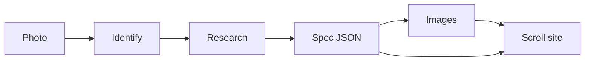

# explode

A photo of a physical thing goes in. A scroll-driven “how it’s made” site comes out.

The page is one pinned film, in the manner of [lunarwheel.it](https://lunarwheel.it) (see [docs/reference-lunarwheel.md](docs/reference-lunarwheel.md)). Scroll scrubs a canvas: the object turns, then comes apart, then the last exploded frame holds while HTML callouts step through each part. The picture is 9:16, centered on a dark studio with the edges vignetted into the page. After the pin, a parts grid, a short essay, and sources. `prefers-reduced-motion` drops the pin and shows the stills in order.

The demo is the [Hamilton Khaki Field Murph 42mm](https://www.hamiltonwatch.com/en-us/h70605731-khaki-field-murph-auto.html), reference **H70605731**. Frames are WebP sequences in `public/murph/frames/` (121-frame turn, 110-frame explosion). The explosion rushes through 4.55s–5.65s of the source clip, where a second crystal flashes. If a spec has no frames, the same pin crossfades the hero still into the exploded still.

Motion is [GSAP](https://gsap.com/) with ScrollTrigger (GreenSock, now free for standard use) and [Lenis](https://github.com/darkroomengineering/lenis) (MIT, darkroom.engineering) for inertial scrolling.

```bash
npm install
npm run dev
```

Then open [http://127.0.0.1:4317](http://127.0.0.1:4317).

## What works without a key

- The Murph demo (`npm run dev`, or `npm run build && npm run preview`).
- Rendering any spec you already have:

```bash
npm run explode -- --from-spec public/spec.json --out ./site
npx serve ./site
```

The first render builds the viewer into `dist-site/` if it is not there yet.

## What needs a key

Identify, research, and image generation call [Vercel AI Gateway](https://vercel.com/docs/ai-gateway) when `AI_GATEWAY_API_KEY` is set. If that variable is empty and `OPENAI_API_KEY` is set, the same steps talk to OpenAI directly.

```bash
cp .env.example .env
# fill in AI_GATEWAY_API_KEY

npx explode ./photo.jpg --out ./site
```

From this repo, before the package bin exists, use:

```bash
npm run explode -- ./photo.jpg --out ./site
```

`npm run build` writes `dist/cli.js`, which is the `explode` bin.

| Step | Default model | Override |
| --- | --- | --- |
| Identify the photo | `google/gemini-2.5-flash` | `EXPLODE_VISION_MODEL` |
| Research the teardown | `anthropic/claude-sonnet-4.5` | `EXPLODE_RESEARCH_MODEL` |
| Edit the photo | `google/gemini-2.5-flash-image` | `EXPLODE_IMAGE_MODEL` |
| Turn and explode clips | `klingai/kling-v2.6-i2v` | `EXPLODE_VIDEO_MODEL` |

The image step is an edit. The uploaded photo is sent as the reference (`prompt.images`), and the prompt asks for a photoreal studio shot of that same object. Other reference-capable gateway ids: `bfl/flux-kontext-pro`, `bfl/flux-3-image`, `openai/gpt-image-1`. Direct OpenAI defaults to `gpt-image-1` and asks for a transparent PNG.

```bash
npm run explode -- ./photo.jpg --skip-images
npm run explode -- ./photo.jpg --from-spec public/spec.json --images --out ./site
```

No secrets belong in the repo. `.env` is gitignored.

The Murph demo is those photographs, plus a 9:16 hero (`murph/hero-916.jpg`) and the frame sequences. Movement, crown, and caseback are representative, and the caseback engraving in the picture is not Hamilton’s production text. The watermarked retailer photo used to generate them is not in the repo. The source mp4s are not in the repo either. To rebuild the sequences:

```bash
npm run explode -- --extract ./rotate.mp4 --frames-dir public/murph/frames/rotation --fps 12
npm run explode -- --extract ./explode.mp4 --frames-dir public/murph/frames/explode --fps 12 --skip 4.55-5.65 --skip-keep 2
```

`--motion` generates both clips from the hero and exploded stills (gateway Kling, Veo, or Seedance, or fal with `EXPLODE_VIDEO_PROVIDER=fal`), then runs the same ffmpeg extract.

## Pipeline



1. **Identify.** A vision model returns maker, model, category, and a confidence score. It is told not to invent a reference number.
2. **Research.** A second call returns the spec: the object, and each component’s name, material, how it is made, a fact or two, and stack order. The prompt tells the model to drop measurements it cannot source.
3. **Images.** The uploaded photo is the reference for three edits: an assembled hero, a photoreal exploded view, and a close-up cutout of each component. Prompts lock studio lighting and a flat `#0c0d0b` ground. A failed edit does not abort the run. The warning is stored on the spec, and that plate stays empty.
4. **Motion.** Optional. An image-to-video model turns the hero into a rotation clip, and uses the hero plus the exploded still as the first and last frames of an explode clip. ffmpeg writes numbered WebP frames. A `--skip` range can drop or rush a bad patch of the clip.
5. **Site.** A static folder: `index.html`, the viewer, `spec.json`, and the frames. One pinned canvas scrubs rotation, then the explosion, then holds the final frame under per-part callouts.
6. **True 3D.** Not built. `src/pipeline/solid3d.ts` is the interface and a `TODO(explode-3d)`. `solid3d.available` is `false`. The film is an image sequence on purpose.

The spec is version `1`. See `src/spec/schema.ts`.

## Agent tool

`runExplode()` in `src/pipeline/run.ts` is the whole pipeline. The MCP server exposes the same steps: `explode_identify`, `explode_research`, `explode_visualize`, `explode_build_site`, `explode_run`.

Details, including a client config, are in [docs/agent.md](docs/agent.md).

```bash
npm run mcp
```

## Layout

```
src/pipeline     identify, research, images, site writer, 3D stub
src/spec         zod schema, stack layout, scroll chapters
src/viewer       scroll page, photographic layers
public/murph/manifest.json   demo photo paths
public/spec.json researched Murph demo
```

`prefers-reduced-motion` skips the pin and shows the exploded stack with buttons.

## Scripts

```bash
npm run dev        # demo on port 4317
npm test           # spec, storyboard, render
npm run typecheck
npm run build      # dist-site/ and dist/cli.js
```

## Roadmap

- Background removal when a model will not return a clean cutout.
- A real image-to-3D provider behind `solid3d.reconstruct`, emitting one glTF per component and driving the same chapters with a camera.
- A service manual pass: torque, oiling points, and what not to touch, when a source actually says so.

## Sources for the demo

The Murph copy is summarized from Hamilton’s H70605731 page, Hamilton’s account of making the Murph, and Caliber Corner and WatchBase on the H-10. Links are in the page footer and in `public/spec.json`. Hamilton does not publish a steel grade for this case. The demo does not call it 316L. The caseback lettering in the photograph is generated.
