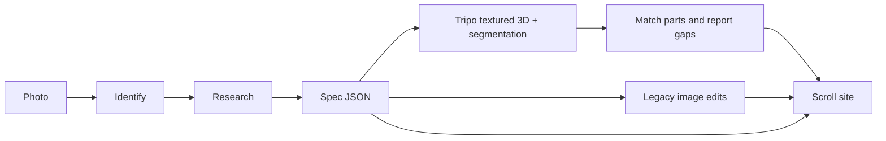

# explode

**Understand the object, then build its explanation.** Explode researches how the parts work and fit together before choosing how to reconstruct them. The 3D scene and text teach that understanding. [Core product principles](docs/research-first.md) · [Murph research and construction brief](docs/research/murph.md).

An open-source engine for exploring physical objects through a continuous, scroll-driven 3D story.

## Current quality and evaluation

The Murph is an authored research prototype, not proof of automatic reconstruction from an arbitrary photo. The upload studio now produces an honest research/construction plan; building and reviewing the parts remains agent work. Missing geometry, approximate surfaces, and untested learning outcomes prevent a quality pass.

Read [the evaluation method and findings](docs/evaluations.md). Run `npm run eval` for reports, `npm test` for regression checks, and `npm run eval:browser` for real exported-model browser checks. `npm run eval:release` deliberately fails while the current specimen falls below the reviewed bar.

## Use with an agent

Point a capable agent at this repository and ask it to use [the Explode skill](skills/explode/SKILL.md) with your photograph, object description, or model. For example: “Use the Explode skill in this repo to research this object and build a continuous 3D explainer. Prioritize fidelity; inspect a short assembled-to-exploded sequence before making the full tour.”

The skill directs research, geometry sourcing/generation, part assembly, visual review, and export. It can use the host agent's tools; an OpenAI API key is not required to render a spec the agent authors. External generation still requires an available provider/account, and a skill does not make arbitrary-photo mechanical reconstruction reliable. The standalone API pipeline below is also supported. This skill is included in the source checkout; it is not automatically installed or connected as an MCP plugin.

The current prototype keeps one object in one scene: turn it, separate its parts, move closer to each component, then return to the overview. Manufacturing stories appear in an expandable anatomy section after the scene. Daylight and Midnight switch the atmosphere; dragging rotates the object; Pause motion stops ambient movement. The Murph study includes direct component selection, a pause control, and a complete written guide; reduced-motion users can inspect every component without the pinned scroll animation.

The default demo uses **Chronograph Watch**, a detailed, textured multipart asset by Eric Chadwick / Darmstadt Graphics Group, derived from graphiccompressor’s model and distributed through Khronos under CC BY 4.0. It preserves the source glass transmission, surface maps, bevels, and second-hand animation. Six explorable assemblies separate along the depth axis, with individually authored camera angles and labels. It is a different watch from the Hamilton Murph and has no internal movement. Attribution and trademark notices ship in `public/models/chronograph/`. The earlier Murph experiment remains at `?demo=murph`.

For other objects, supply a multipart GLB and map its named nodes to the explainer's components. See [the 3D authoring guide](docs/3d-scenes.md). A new photo-to-3D draft pipeline integrates Tripo generation and semantic segmentation. It has contract/fixture tests and two completed live watch trials; both assets failed the intended visual/component quality target. See [the first trial findings](docs/tripo-watch-trial.md) and [the Murph study](docs/murph-reconstruction-trial.md). Accurate hidden-part reconstruction remains unsolved. The existing photograph pipeline and frame-sequence viewer remain available for specs without `scene3d`.

Scroll choreography uses [Basement Scrollytelling](https://github.com/basementstudio/scrollytelling) (MIT), GSAP ScrollTrigger, and Lenis. Three.js renders the model using a photographic softbox environment. Camera framing uses actual geometry bounds, including portrait layouts; neighboring parts recede while a component is being inspected.

```bash
npm install
npm run dev
```

Then open [http://127.0.0.1:4317](http://127.0.0.1:4317).

Requires Node.js 22.12 or newer.

## What works without a key

- The Chronograph demo (`npm run dev`).
- The packaged research-led Murph: `npm ci && npm run build && npm run studio`, then open [the study](http://127.0.0.1:4319/murph-study/index.html). The model, lighting and fonts are included; no private work directory or API key is required. See [asset provenance](public/models/murph/ATTRIBUTION.md).
- Rendering any spec you already have:

```bash
npm run explode -- --from-spec public/chronograph.json --out ./site
npx serve ./site
```

The first render builds the viewer into `dist-site/` if it is not there yet.

## Generate from a photograph

```bash
cp .env.example .env
# Set OPENAI_API_KEY locally for photo identification and research.
npm run build
npm run studio
```

Open [the upload studio](http://127.0.0.1:4319/create). Choose a PNG or JPEG photo, then **Research this object**. The studio identifies the object, researches its construction, and saves `research.json` and `construction-plan.json`. It does **not** purchase or generate geometry. Give those files to an agent using the Explode skill to source/build, assemble and evaluate the components. Jobs remain in ignored `.explode-jobs/` and interrupted research can resume after a restart.

CLI: `npm run explode -- ./photo.jpg --plan --out ./research`. Existing research needs no credentials: `npm run explode -- --from-spec evals/cases/iphone-18-pro.json --plan --out ./research`. MCP `explode_run` accepts `planOnly: true`.

The separate `--3d` adapter requires Tripo and OpenAI credentials. It only proceeds when the research plan explicitly permits an exterior draft; plans requiring independent internal parts stop before a paid geometry call.

**Current boundary:** the provider reconstructs an exterior from a photo. Research informs the component inventory and explanations, but does not synthesize missing internal geometry. A coverage report lists missing and unidentified parts. Assignments use semantic mesh names and need visual review. A single fused or unidentifiable output does not become a fake teardown. Generation uses external, paid APIs; the MIT application does not include model weights or provider credits. See [generation details and recovery](docs/photo-to-3d.md).

## What needs a key

Identification, structured writing, and image generation use Vercel AI Gateway when configured, or direct OpenAI otherwise. Web-backed research always needs `OPENAI_API_KEY`. The 3D branch additionally needs `TRIPO_API_KEY`. All credentials stay in the local server environment.

```bash
cp .env.example .env
# fill in OPENAI_API_KEY (and optionally AI_GATEWAY_API_KEY)

npx explode ./photo.jpg --out ./site
```

From this repo, before the package bin exists, use:

```bash
npm run explode -- ./photo.jpg --out ./site
```

`npm run build` writes `dist/cli.js`, which is the `explode` bin.

| Step | Default model | Override |
| --- | --- | --- |
| Identify the photo | `google/gemini-2.5-flash` | `EXPLODE_VISION_MODEL` |
| Research the teardown | `anthropic/claude-sonnet-4.5` | `EXPLODE_RESEARCH_MODEL` |
| Edit the photo | `google/gemini-2.5-flash-image` | `EXPLODE_IMAGE_MODEL` |
| Turn and explode clips | `klingai/kling-v2.6-i2v` | `EXPLODE_VIDEO_MODEL` |

The image step is an edit. The uploaded photo is sent as the reference (`prompt.images`), and the prompt asks for a photoreal studio shot of that same object. Other reference-capable gateway ids: `bfl/flux-kontext-pro`, `bfl/flux-3-image`, `openai/gpt-image-1`. Direct OpenAI defaults to `gpt-image-1` and asks for a transparent PNG.

```bash
npm run explode -- ./photo.jpg --skip-images
npm run explode -- ./photo.jpg --from-spec public/spec.json --images --out ./site
```

No secrets belong in the repo. `.env` is gitignored.

The photographic fallback assets include those photographs, plus a 9:16 hero (`murph/hero-916.jpg`) and the frame sequences. Movement, crown, and caseback are representative, and the caseback engraving in the picture is not Hamilton’s production text. The watermarked retailer photo used to generate them is not in the repo. The source mp4s are not in the repo either. To rebuild the sequences:

```bash
npm run explode -- --extract ./rotate.mp4 --frames-dir public/murph/frames/rotation --fps 12
npm run explode -- --extract ./explode.mp4 --frames-dir public/murph/frames/explode --fps 12 --skip 4.55-5.65 --skip-keep 2
```

`--motion` generates both clips from the hero and exploded stills (gateway Kling, Veo, or Seedance, or fal with `EXPLODE_VIDEO_PROVIDER=fal`), then runs the same ffmpeg extract.

## Pipeline



1. **Identify.** A vision model returns maker, model, category, and a confidence score. It is told not to invent a reference number.
2. **Research.** OpenAI web search gathers cited evidence. A structured pass writes the component inventory and marks documented versus inferred construction. Source URLs are restricted to returned web citations; this is provenance tracking, not independent fact verification.
3. **Images.** The uploaded photo is the reference for three edits: an assembled hero, a photoreal exploded view, and a close-up cutout of each component. Prompts lock studio lighting and a flat `#0c0d0b` ground. A failed edit does not abort the run. The warning is stored on the spec, and that plate stays empty.
4. **Motion.** Optional. An image-to-video model turns the hero into a rotation clip, and uses the hero plus the exploded still as the first and last frames of an explode clip. ffmpeg writes numbered WebP frames. A `--skip` range can drop or rush a bad patch of the clip.
5. **Export.** A static folder containing the viewer, spec, and assets. Local self-contained GLB files are copied from the spec directory when using `--from-spec`.
6. **3D viewer.** Three.js renders procedural or imported multipart models. `scene3d` selects this path; otherwise the image-sequence viewer is used. `--3d` uses the Tripo adapter in `src/pipeline/three/`, validates the GLB, and creates a scene manifest plus coverage report. This path does not synthesize missing internal parts.

The spec is version `1`. See `src/spec/schema.ts`.

## Agent tool

`runExplode()` in `src/pipeline/run.ts` is the whole pipeline. The MCP server exposes the same steps: `explode_identify`, `explode_research`, `explode_visualize`, `explode_build_site`, `explode_run`.

Details, including a client config, are in [docs/agent.md](docs/agent.md).

```bash
npm run mcp
```

## Layout

```
src/pipeline     identify, web research, generation, static export
src/studio       local upload server and creation interface
src/spec         zod schema, component mapping, scroll timing
src/viewer       pinned scene, image fallback, anatomy
src/viewer/three model loading, procedural watch, camera, atmosphere
public/murph/manifest.json   demo photo paths
public/chronograph.json      default multipart watch study
public/models/chronograph    licensed source model and attribution
public/spec.json             earlier researched Murph demo
```

`prefers-reduced-motion` skips the pin and presents available stills and the anatomy.

## Scripts

```bash
npm run dev        # demo on port 4317
npm run studio     # upload studio on port 4319, after build
npm test           # spec, geometry, provider contracts, local server, export
npm run typecheck
npm run build      # dist-site/ and dist/cli.js
```

## Roadmap

- Background removal when a model will not return a clean cutout.
- Higher-fidelity multipart objects and authored camera choreography.
- Live quality evaluation across watches, cameras, shoes, and simpler objects.
- Visually grounded component matching, missing internal geometry generation from documented references, and human correction tools.
- A service manual pass: torque, oiling points, and what not to touch, when a source actually says so.

## Sources for the Murph study

The Murph copy is summarized from Hamilton’s H70605731 page, Hamilton’s account of making the Murph, and Caliber Corner and WatchBase on the H-10. Links are in the page footer and in `public/spec.json`. Hamilton does not publish a steel grade for this case. The demo does not call it 316L. The caseback lettering in the photograph is generated.

## Licenses

Explode code is MIT. Third-party software and model assets retain their own terms; the Chronograph model and derived renders are CC BY 4.0 with separate logo notices. See [THIRD_PARTY.md](THIRD_PARTY.md).


### Second-object preview and agent handoff

After `npm run build && npm run studio`, open:

- Murph: <http://127.0.0.1:4319/murph-study/index.html>
- iPhone assembly prototype: <http://127.0.0.1:4319/iphone-study/index.html>
- Studio and example links: <http://127.0.0.1:4319/create>

The phone has actual separate 3D parts, built through the reusable recipe exporter. Its internal geometry is **schematic**, not a photorealistic reconstruction or proof of automatic photo-to-internals generation. The original research-only phone evaluation remains a separate negative case.

An agent can author `research.json` plus `assembly.json`, then use `--assemble` or the `explode_assemble` MCP tool. Open the resulting `assembly-project.json` in the studio to build and review it without API keys. Existing multipart GLB imports remain the route for detailed/organic geometry beyond the recipe vocabulary. See [the construction contract](docs/3d-scenes.md#build-an-agent-authored-component-recipe).
